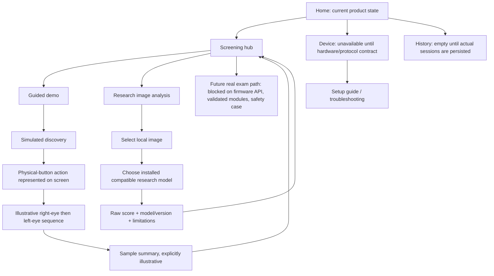

# Golden Retina Mobile Product Foundation

**Directive:** GR-APP-DESIGN-001, v1.0
**Status:** Working product and interaction specification; not clinical, regulatory, or hardware approval.

The frozen local-only inference and result semantics are detailed in [`mobile_product_architecture_20261121.md`](mobile_product_architecture_20261121.md), and the RFMiD condition/finding taxonomy and result wording are specified in [`mobile_result_content_contract_20261121.md`](mobile_result_content_contract_20261121.md).

## Product purpose

Golden Retina's companion apps explain and coordinate a future retinal screening headset. At the current repository state, the apps provide an explicitly simulated guided demo and an on-device research-model lab. The demo does not capture images, connect to the headset, or generate medical findings. The research lab can execute installed image models on a user-selected image; outputs are raw model scores and are not calibrated disease risk or diagnoses.

The product goal is to help an adult understand readiness, prepare for a session, follow a device-led exam without repeated phone interaction, and understand only those outputs that have been supported by evidence and a documented device/API contract.

## Users and jobs

- **Adult screening participant:** understand the limits, prepare, start the headset-led session, review a comprehensible result, and decide what follow-up to seek.
- **Caregiver:** assist with setup and observe progress without taking ownership of another adult's health data.
- **Clinician receiving a report:** see provenance, eye, date, quality, model/version, and limitations without the app claiming a diagnosis.

No pediatric workflow, household health-record sharing, account service, clinician portal, or personalized screening schedule is currently specified or implemented.

## Product capability states

| State | Meaning | UI treatment |
|---|---|---|
| Research / Demonstration | Simulated scan or unvalidated research model | Persistent “Demo” or “Research model” context; sample outputs marked illustrative; raw scores never renamed risk |
| Validated capability | A specified feature supported by validation and approved release evidence | May only be enabled after evidence, product owner approval, and a versioned capability contract exist |
| Unavailable / Future | Hardware, protocol, clinical validation, or service does not exist | Explain the missing dependency and offer safe navigation; do not start permissions/discovery or imply readiness |

These labels are global content rules. “Complete” means the simulation completed, not a clinical examination.

## User journey and recovery map

**Recovery rules:** preserve local research image handling; give an explanation and retry route for model/download failures; do not claim a scan was saved if no real acquisition occurred; do not trigger discovery permissions before a supported connection method is documented; if future capture is interrupted, defer persistence semantics and safe-stop controls to the hardware/firmware contract.

## Information architecture

Five top-level destinations keep the primary action prominent while grouping related tools:

1. **Home** — product status, next action, demo/research distinctions.
2. **Screening** — guided simulation and on-device image research.
3. **History** — actual completed sessions only; currently an honest empty state.
4. **Device** — connection/readiness/maintenance; currently unavailable with explanation and guide.
5. **Settings** — appearance, accessibility guidance, privacy information, language readiness, model registry, help/about.

Native navigation remains platform-specific. iOS uses a native tab bar and navigation stacks; Android uses Material 3 bottom navigation and system Back. The guide is contextual help, not a peer-level destination.

## Creative-direction evaluation

Scores are design judgments (1–5), not user-research results.

| Direction | Trust | Accessibility | Seriousness | Recognition | Native fit | Scalability | Implementability | Total / 35 |
|---|---:|---:|---:|---:|---:|---:|---:|---:|
| A — Clinical Precision | 5 | 4 | 5 | 3 | 5 | 5 | 5 | 32 |
| B — Human-Centered Calm | 4 | 5 | 4 | 3 | 5 | 4 | 5 | 30 |
| C — Scientific Premium | 4 | 4 | 5 | 5 | 4 | 4 | 4 | 30 |

**Selected: Clinical Precision, softened with Human-Centered Calm and a restrained Scientific Premium accent.** This works for empty/error states and technical research outputs as well as the home screen; it does not rely on decorative retinal graphics or dense dashboards. Scores are an internal rationale only and need usability validation.

## Product success measures (future usability study)

Measure task completion, critical errors, time, assistance required, result comprehension, understanding of screening-vs-diagnosis, recovery success, and accessibility barriers. No participant research has been performed for this specification; no results are asserted.

## Assumption and dependency register

| ID | Unknown / dependency | Safe current design | Owner/evidence needed to unlock |
|---|---|---|---|
| D-01 | Actual headset discovery and transport (Bluetooth/Wi-Fi/other) | Device stays unavailable; no scan or permission prompt | Kerem: firmware/SDK protocol, service/characteristics, pairing lifecycle |
| D-02 | Device capabilities, telemetry, eye/camera status | No invented battery, signal, calibration, or capture data | Versioned capability/status schema and hardware validation |
| D-03 | Exam state machine, button semantics, pause/stop behavior | Demo represents physical button with an on-screen action; actual exam blocked | Firmware state machine, safety stop/fault contract, test evidence |
| D-04 | Actual camera format, fields, orientation, image metadata | No fabricated live preview or viewer anatomy | Capture contract, orientation/eye/field metadata, sample fixtures |
| D-05 | Clinically supported conditions and result categories | No disease-risk claims; research lab only | Per-condition clinical validation, thresholds, labeling, authorization |
| D-06 | Model calibration and uncertainty | Display raw score only with research notice | Calibration/validation report and output schema |
| D-07 | Accounts, cloud, sharing, deletion, backups | Do not claim these services exist | Security/privacy architecture, threat model, legal review |
| D-08 | Usability and medical copy | Language remains product-concept wording | Adult participants, low-vision/accessibility study, clinical review |
| D-09 | English/Turkish final medical terminology | Prepare localization structure and content keys | Qualified human translation and clinical review |
| D-10 | Real exam history and comparable longitudinal metrics | History is empty; no trends are synthesized | Persisted-session schema, version compatibility and comparability policy |

## Scope exclusions

Do not redesign the headset; add hardware; implement proprietary diagnostic algorithms; create ungrounded disease predictions; fabricate patient records, overlays, live eye tracking, or user-study outcomes; or claim compliance/clinical deployment readiness.
